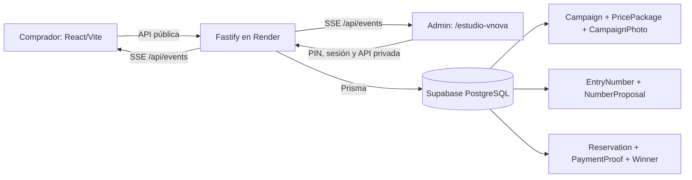
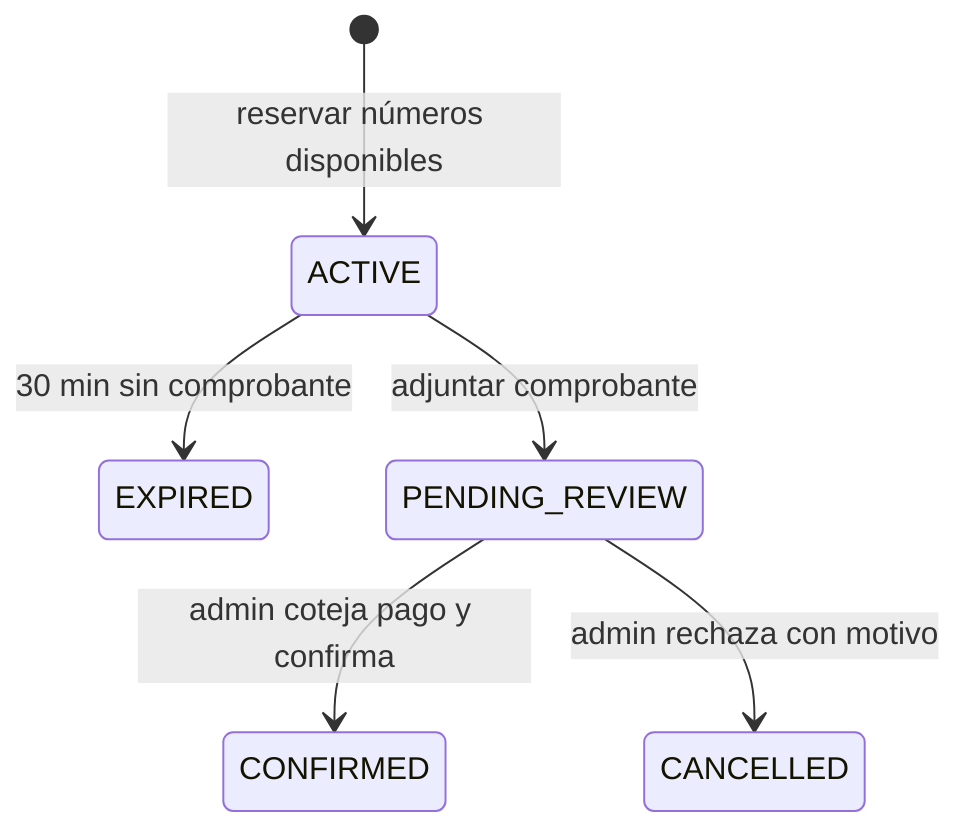

# Cifraya — mapa compacto del proyecto

Leer este archivo primero en futuras sesiones. Para una relación concreta entre archivos o funciones, consultar [`graphify-out/graph.json`](../graphify-out/graph.json) o ejecutar `graphify query "pregunta" --budget 800`. El [grafo interactivo](../graphify-out/graph.html) permite explorar visualmente el código. El grafo automático cubre código; este mapa añade reglas de negocio y decisiones.

## Rutas y archivos

| Nodo | Responsabilidad | Fuente |
|---|---|---|
| Web pública | Inicio `/`, `/buscar-boletos`, `/ganadores`, `/rifa/:slug`; selección, reserva, comprobantes, podio y footer social | `apps/web/src/App.tsx`, `apps/web/src/WinnersPodium.tsx`, `apps/web/src/FooterSocials.tsx` |
| Centro de control | `/estudio-vnova`; creación y edición de rifas, boletos tipo tarjeta, ganador e historial | `apps/web/src/App.tsx`, `EditRaffle.tsx`, `AdminRaffleDetail.tsx` |
| Participantes y pagos | Ficha privada por correo; revisión manual de comprobantes | `AdminParticipantDetail.tsx`, `AdminReservationReview.tsx` |
| API | Rutas, validación, autenticación, reservas atómicas y SSE | `apps/api/src/server.ts` |
| Vencimientos | Liberación transaccional de apartados y coordinación de consultas simultáneas | `apps/api/src/reservationExpiry.ts` |
| Seguridad HTTP | Cabeceras CSP, bloqueo de marcos y caché privada | `apps/api/src/security.ts` |
| Búsqueda privada de boletos | Prefijos según el ancho del número y coincidencias por comprador | `apps/api/src/ticketSearch.ts`, `apps/web/src/AdminRaffleDetail.tsx` |
| Números invertidos | Inversión con ancho fijo, selección de pares disponibles y rechazo de duplicados | `apps/api/src/invertedNumbers.ts` |
| Datos | Modelos e índices; migraciones aplicadas al arrancar Render | `prisma/schema.prisma`, `prisma/migrations/` |
| Despliegue | Una web/API Node en Render; PostgreSQL externo en Supabase | `render.yaml` |

## Flujo de boletos

- Rifas admiten **100, 1.000, 10.000 o 100.000 números** (`00–99`, `000–999`, `0000–9999`). La compra se hace escogiendo un paquete; el comprador elige entre asignación aleatoria (cinco regeneraciones) o selección manual de esa cantidad de números disponibles. ManualNumbers.tsx muestra páginas de 100, búsqueda por prefijo y estados actualizados por SSE; la API valida cantidad, duplicados, disponibilidad y reserva final en transacción serializable. El precio de la reserva es el precio exacto del paquete. Sin paquetes configurados, se ofrece un boleto individual como compatibilidad.
- El administrador puede habilitar invertidos en un borrador para ofrecer un paquete adicional. Se invierte el número con su ancho fijo: `1200 → 0021`. Si el comprador agrega los invertidos, recibe exactamente un número inverso distinto por cada número base y paga **dos veces** el precio del paquete. Se ofrecen solo si todos están disponibles y no se repiten ni coinciden con números base. El servidor vuelve a validarlos y reclama el conjunto completo de forma atómica al reservar. `Reservation.baseValues` distingue los números originales de los invertidos; la forma de compra no determina qué premio gana un número: los premios inversos se configuran por posición. Configuración inmutable tras publicar.
- El progreso público usa exclusivamente números con estado `SOLD` dividido entre la cantidad total de la rifa; los apartados no cuentan. La página abierta lo actualiza por eventos y con consulta de respaldo cada 120 segundos con SSE activo (20 si falla). El porcentaje se redondea hacia abajo para evitar mostrar 100% antes de la venta total.
- Los premios son una lista ordenada `Campaign.prizes`; la cantidad se deriva de ella y no puede superar el inventario de números (máximo actual 10.000). El editor reutilizable `PrizeEditor.tsx` permite escribir la cantidad y paginar diez campos. `prize`, `secondPrize`, `thirdPrize` y `prizeCount` se mantienen sincronizados por compatibilidad; la migración conserva las posiciones de rifas existentes. Los resultados se publican en orden y la rifa se cierra al publicar la última posición. Los premios directos requieren boletos vendidos y resultados directos distintos. El podio muestra los tres primeros y tarjetas paginadas desde el cuarto. La API consulta premios una vez por rifa y devuelve solo el premio correspondiente y los tres del podio por resultado, evitando duplicar listas completas por cada ganador.
- Edición: un borrador permite cambiar URL, precio, cantidad de números, paquetes y premios; al cambiar la cantidad se reconstruye el inventario dentro de una transacción, siempre sin reservas. Una rifa publicada o cerrada solo permite corregir título y descripción; fotos se administran por separado.
- La selección manual (cada clic) y aleatoria bloquea números por cinco minutos desde el primer clic/generación, sin extender el plazo al cambiar. `selectionHolds.ts` coordina todas las instancias mediante bloqueo de fila de Campaign y reclamaciones condicionales de EntryNumber (holdKey/holdExpiresAt). Los invertidos se bloquean al agregarlos; deseleccionar o reemplazar libera los anteriores. Los holds vencidos son seleccionables inmediatamente y el trabajador limpia campos y notifica SSE. El GET público muestra HELD para otra sesión sin revelar su clave. La reserva sí los reclama en transacción serializable; un conflicto debe devolver 409. Un comprobante presentado a tiempo conserva el apartado durante la revisión, sin vencimiento automático de 48 horas. Solo una compra confirmada recibe premio. Un resultado inverso sin boleto vendido se registra sin ganador.
- Fotos del premio: hasta tres; comprobantes: hasta tres. Cada imagen guardada pesa como máximo 2 MB. **Ambos tipos se guardan hoy en PostgreSQL**, no en Supabase Storage. El administrador debe cotejar SINPE con el dinero realmente recibido; la foto sola no verifica el pago.
- La ficha mini CRM relaciona reservas por correo electrónico sin distinguir mayúsculas, con historial paginado. Es una agrupación práctica, no una identidad verificada.
- En la vista privada de una rifa, buscar `00` encuentra todos los boletos cuyo número mostrado empieza por `00` (`0000–0099` en una rifa de cuatro dígitos). El mismo campo busca nombre, correo y teléfono de quien apartó o compró; el estado se aplica junto con la búsqueda.
- Los cambios se propagan por una conexión SSE compartida por pestaña visible (`apps/web/src/realtime.ts`). Se agrupan ráfagas durante 250 ms; el respaldo consulta cada 120 segundos con SSE activo o 20 segundos sin conexión SSE. Reconectar y volver a la pestaña sincronizan inmediatamente; ocultarla cierra SSE. El servicio gratuito de Render puede dormir; SSE no equivale a disponibilidad garantizada 24/7.
- La API limita a 200 conexiones SSE simultáneas por proceso y comparte una sola ejecución de vencimiento cuando coinciden solicitudes. Las cargas de fotos se serializan para respetar el máximo de tres incluso con peticiones concurrentes.
- El PIN admin crea una sesión HMAC de ocho horas firmada con `ADMIN_TOKEN` (`apps/api/src/adminSession.ts`); sobrevive reinicios del proceso. Si vence, el formulario de borrador permanece en estado de la pestaña mientras se vuelve a ingresar el PIN.

## Reglas de trabajo

- Identidad visual Vnova TCG: naranja #ff4200, azul #395aff, rojo #ff2c2c, blanco y #191919; estilos centralizados en apps/web/src/brand.css, logo vectorial original en public/vnova-logo.svg. Mantener los colores originales de WhatsApp, Facebook e Instagram en el footer; las preguntas van dentro de la interfaz. Evitar texto de “prueba” en el producto público.
- El footer muestra WhatsApp, Facebook e Instagram con relleno y tooltip de marca. Enlaces predeterminados: WhatsApp +506 72833548, Instagram vnova_tcg y Facebook perfil 61595720213836. Se pueden sustituir con URL HTTPS VITE_CIFRAYA_*_URL al compilar.
- Inicio muestra paquetes de la rifa principal directamente; elegir uno abre `/rifa/:slug` y solicita sus números. El indicador de diez barras aparece al cargar desde Inicio y al generar o cambiar el conjunto completo en la rifa.
- No publicar credenciales, PIN, comprobantes ni datos personales en este grafo. Las rutas admin requieren sesión; los comprobantes solo se sirven con autorización.
- Verificar con `pnpm db:generate`, `pnpm build` y `git diff --check` cuando cambien esquema o código. Para actualizar el grafo automático tras cambios de código: `graphify extract . --code-only` y `graphify cluster-only . --no-label`.

## Premios directos e inversos

- `Campaign.prizeSources` tiene una entrada por premio: 0 es directo; un entero positivo apunta a una posición directa anterior. Se rechazan referencias futuras, a sí mismo o a otro inverso.
- El servidor deriva el inverso del resultado de esa posición con el ancho de la rifa (1234 → 4321, 1200 → 0021). El administrador revisa el número y comprador calculados antes de publicarlo; no puede sustituirlo por otro número.
- Si el inverso no está vendido, la publicación queda sin ganador (`Winner.reservationId = null`), claramente identificada, y permite continuar con los premios posteriores. Un palíndromo puede recibir su premio directo e inverso por separado. La unicidad se conserva por posición, no por número entre premios de tipos diferentes.
- La migración conserva las rifas anteriores con todas sus posiciones directas. La opción global antigua `invertedPrizeEnabled` se conserva por compatibilidad, derivada de las reglas, pero ya no determina elegibilidad por tipo de compra.

## Preparación operativa

- `apps/api/src/publicCache.ts` deduplica lecturas públicas y conserva resultados dos segundos; cada broadcast invalida la caché. Datos privados quedan fuera.
- Los vencimientos se agrupan y tienen pausa de cinco segundos si el lote no está lleno. SSE descarta consumidores lentos; SIGTERM cierra flujos y Prisma.
- `/api/ready` verifica PostgreSQL. API usa no-store y el registro de solicitudes oculta tokens.
- Pruebas y límites reales de despliegue: `docs/PRODUCTION.md`. Ejecutar `pnpm test:production` y `pnpm audit --prod`.

## Detalle del pedido

- `/pedido#<codigo-privado>` muestra `OrderDetail.tsx`: número CY, estado, comprador, fecha en Costa Rica, total SINPE, paquete, boletos e inversos, motivo de rechazo y carga de comprobantes. Usa la consulta POST existente y eventos compartidos, sin una conexión SSE adicional.
- `Reservation.orderNumber` es un entero único autoincremental asignado al reservar y conservado al aprobar/rechazar. La migración asigna números también a reservas anteriores. Es una referencia, nunca una credencial.
- El enlace usa un fragmento para no enviar el código en la URL de la página o en Referer. El detalle no expone correo, teléfono ni comprobantes. Admin ve el mismo número de pedido en la revisión privada. Los correos automáticos usan paymentEmails.ts y la cola persistente EmailNotification; activación DNS/secretos en docs/EMAILS.md.

- Cambio visual Vnova TCG (2026-10-19): nombre público y metadatos actualizados; rutas existentes, códigos CY y claves de configuración se mantienen para compatibilidad. Tipografía de marca pendiente del archivo adjunto mencionado en el manual.

- La ruta antigua /estudio-cifraya se normaliza a /estudio-vnova al abrir la web, conservando subrutas, búsqueda y fragmento.

## Correos de pago

La aprobación/rechazo encola un mensaje en la misma transacción; un trabajador interno envía por Resend tras confirmar la transacción. Reintentos con clave de idempotencia, payload estable y ventana menor a 24 h. La revisión privada muestra estado del envío. Sin claves, no consulta la cola ni envía; las decisiones nuevas se conservan pendientes.
Diagnóstico de correo: POST/GET /api/admin/email-tests usa la misma cola y plantillas con indicador de prueba, sin reservar ni vender boletos. EmailNotification.reservationId es opcional solo para estos mensajes; la operación de pago conserva su relación y unicidad.
Notificaciones de reserva: RESERVED al reclamar números; PENDING_REVIEW solo en la transición ACTIVE a PENDING_REVIEW con el primer comprobante. Se conserva el diseño común. /api/health incluye la revisión corta del despliegue para verificar actualizaciones sin operaciones sobre datos.

## Auditoría de reservas

`scripts/reservation-audit.mjs` prueba HTTP y PostgreSQL real aislado: 12 selecciones y reservas simultáneas del mismo número (una acepta, once 409), 30 selecciones mixtas a través de dos procesos API sin números compartidos, conflictos entre paquetes, ausencia de reservas/correos huérfanos, duración de 30 minutos, comprobante tardío, conservación al revisar y exclusión de vendidos. No usa la base de producción ni envía correos. Instrucciones en docs/RESERVATION_AUDIT.md. El contador de la web se sincroniza con Date del servidor y avanza con reloj monotónico. La propuesta y su bloqueo exclusivo vencen a los cinco minutos. Confirmar los datos convierte atómicamente el bloqueo propio vigente en una reserva de 30 minutos para adjuntar el primer comprobante.

## Studio: distribución y comprobación

El centro de control usa dos secciones de ancho completo (Tus rifas y Nueva rifa), conservando el formulario montado al cambiar para no perder el borrador. Tarjetas de gestión en dos columnas en escritorio y una en pantallas pequeñas; estilos en brand.css. El encabezado Studio usa #ff4200. `scripts/security-audit.mjs`, ejecutado desde reservation-audit.mjs, prueba 18 rutas administrativas con credenciales ausentes/falsas, privacidad, precios, imágenes inválidas, límites de PIN y creación/edición de 10/20 premios. El manejador de errores oculta detalles de base de datos y devuelve 409 para identificadores duplicados.

Los desplegables de cantidad de números (crear/editar) y origen del premio inverso usan BrandSelect.tsx: menú oscuro propio, selección naranja, teclado y validación requerida del formulario. No agregan dependencias.

## Compra de stickers (2026-10-20)

Nuevas rifas/borradores usan Campaign.numbersPerSticker (1–20); priceCrc es el precio de un sticker. StickerPicker permite cantidad libre dentro del máximo de 100 números base por pedido. El servidor exige grupos completos y calcula cantidad × precio; conserva hasta 1.000.000.000 CRC base para evitar desbordamientos al añadir invertidos. Reservation guarda stickerCount y numbersPerSticker, mostrados en pedido y correos. Campos null conservan paquetes/precios de rifas anteriores sin migración comercial. La selección temporal y el sorteo no cambian: pendiente confirmar regla JPS con usuario. Tres fotos nuevas por rifa; fotos anteriores no se borran. scripts/sticker-audit.mjs cubre 15 stickers/30 números/₡30.000, fraude de precio/cantidad, exclusividad, pedido/correo y cuarta foto rechazada.

## Tarjetas y resultados JPS (2026-10-20)

StickerPicker muestra tarjetas de 1/2/3/5/10/15 stickers, filtradas por límite del pedido; Otra cantidad conserva el campo libre. Precio y números incluidos siempre proporcionales, sin descuentos ni regalos ficticios.

prizeSources: 0 manual; -1 composición desde primer premio JPS; -2 desde segundo; positivo inversión de una posición anterior directa o JPS. lotteryResults.ts compone ancho 2/3/4/5, concatenando números oficiales de dos cifras y, para anchos impares, solo último dígito del siguiente. Cinco dígitos desde segundo usa segundo+tercero+último del cuarto. Inversión 123→321. Nueva cantidad 100.000 con rangos hasta99999, páginas100.

LotteryDrawPanel pide referencia del sorteo y resultados necesarios, calcula por API autenticada draw-preview y requiere confirmación separada. winner vuelve a calcular y guarda drawResults/drawReference en la misma transacción; tras primera publicación no admite cambios. Resultado calculado no vendido se publica sin ganador, sin sustituirlo. Premios JPS pueden coincidir por fórmula; manuales conservan restricción de repetición. Rifas publicadas conservan reglas inmutables. No hay lectura automática de JPS: administrador verifica datos.

scripts/lottery-audit.mjs prueba inventario100k, vista previa con autorización, manipulación del resultado, inversión, inmutabilidad de resultados, cierre. Pruebas unitarias de composición incluyen ceros iniciales.

### Tarjetas de stickers configurables
- `StickerCardEditor` compartido entre creación y edición de borradores: cantidad de stickers y precio total por tarjeta (máximo 10).
- Se reutiliza `PricePackage`: `quantity` siempre representa números, también en modo stickers; UI convierte stickers × numbersPerSticker. No requiere migración.
- Con tarjetas configuradas, propuesta y reserva solo aceptan las cantidades ofrecidas; `purchaseOffer` toma el precio exacto del servidor. Sin tarjetas se mantiene el cálculo individual para compatibilidad.
- Rifas publicadas conservan sus reglas/precios. Pruebas en `stickers.test.mjs` y `scripts/sticker-audit.mjs` cubren precios personalizados, cantidades inválidas y manipulación del total.

### Edición de tarjetas publicadas
- PATCH admin permite reemplazar tarjetas en campañas LIVE, sin modificar números por sticker, inventario ni premios. CLOSED continúa restringida a nombre/descripción.
- Reservas existentes guardan totalCrc, stickerCount, numbersPerSticker y selectedValues; editar tarjetas nunca escribe esos pedidos.
- La reserva vuelve a consultar la oferta dentro de su transacción serializable y valida expectedTotalCrc del checkout. SSE actualiza tarjetas y cancela selecciones visuales antiguas para solicitar una nueva elección.
- sticker-audit verifica edición LIVE, snapshots pendientes/confirmados, rechazo de precio anterior y retiro de cantidades.

### Pruebas aisladas en el servidor publicado
- Campaign.isTest (false por defecto) solo se fija al crear desde API admin. Las rifas técnicas no aparecen en catálogo ni ganadores públicos; sus rutas de campaña, números, selección y reserva requieren sesión admin.
- enqueuePaymentEmail omite por completo la cola de notificaciones para isTest.
- finish-test solo admite isTest, pausa la campaña y cancela sus pedidos/libera números en una transacción. Conserva montos y selecciones como evidencia; rechaza campañas reales.
- scripts/published-price-audit.mjs usa las rutas normales de producción con una rifa técnica y finaliza en finally; se prueba primero en la base aislada. No imprime tokens ni credenciales.

### Fotos adaptables del premio
- brand.css limita la altura de portada y detalle, usa object-fit:contain y centra la imagen completa. En móvil la foto precede al contenido de compra; la portada ya no estira la foto con la altura de las tarjetas.
- Verificación visual de portada con foto real en escritorio y viewport 390×844; compilación web correcta.

- Galería pública: PrizePhoto.tsx abre las fotos del premio en un dialog modal nativo desde Inicio y detalle, con anterior/siguiente circular, teclado, gesto horizontal y ajuste contain. Restaura el foco y el scroll al cerrar; no modifica reservas.

- Revisión móvil: CheckoutDialog.tsx usa dialog nativo con foco y scroll controlados. Autocompletado y teclado telefónico, tarjetas en dos columnas y acceso directo a compra. Resultados y límites de la auditoría en docs/MOBILE_SECURITY_REVIEW.md.

- Todos los correos nuevos del pedido incluyen el lookupToken completo como código copiable (HTML y texto), más el enlace privado existente. Diagnósticos no incluyen códigos reales; no se reescriben mensajes ya encolados. Pruebas en paymentEmails.test.mjs. Buscar boletos separa botón, pase y comprobantes con gap de 20 px.

## Galería y fecha del sorteo (2026-10-20)
- PrizePhoto muestra una imagen completa y miniaturas seleccionables debajo; abre el modal en la imagen elegida. Reutilizado en Inicio y detalle, hasta tres fotos.
- Campaign.drawMode: DATE, SOLD_OUT o ANNOUNCED. DrawScheduleEditor permite editar modalidad y fecha en borradores y rifas LIVE. Los campos se conservan cuando no se envían; CLOSED no admite cambios de fecha. Migración conserva fechas existentes como DATE.
- Fecha/hora de administración siempre representa Costa Rica (UTC-6), almacenada en UTC. DrawCountdown actualiza localmente cada segundo, sin peticiones adicionales. Es informativo: llegar a cero NO cierra ventas, no libera reservas ni declara ganadores. Sin fecha muestra Hasta agotar números o Fecha por anunciar.
- Validación y pruebas: drawSchedule.ts, drawSchedule.test.mjs y sticker-audit.mjs verifican fechas, modalidades, edición sin alterar pedidos y ventas después de vencer la cuenta regresiva.
- SiteHeader.tsx: navegación móvil hasta 800 px con logo y botón de menú en una fila de 80 px; desplegable accesible, cierre al navegar, tocar fuera, salir con teclado, Escape, cambio de tamaño o historial. Escritorio conserva enlaces visibles.

## Ventas presenciales desde administración (2026-10-20)
- Gestionar rifa LIVE -> Registrar venta abre AdminSale.tsx: datos del comprador, tarjeta/precio vigente, selección aleatoria o ManualNumbers, imagen de comprobante. Reutiliza preparePhoto.ts para compresión y validación.
- POST /api/admin/reservations exige sesión y comparte createReservation con el flujo público: hold temporal, transacción serializable, precio calculado en servidor, correos de reserva. Solo respuestas autenticadas incluyen reservationId.
- Luego adjunta comprobante al pedido existente y queda PENDING_REVIEW, sin confirmación automática. Si falla la imagen se conserva el pedido en el formulario y se reintenta únicamente la carga; también se recupera en Boletos y personas. Revisión/aprobación usa el flujo habitual y sus correos.
- Pruebas: 33 unitarias, auditoría aislada con 21 rutas administrativas, sesión ausente/falsa, creación administrativa con comprobante y estado de revisión, concurrencia de selección manual/aleatoria. UI probada en escritorio y 390 px; inspección de textos claros sobre fondos claros en listado, creación, edición, inventario, revisión de pago y formulario de venta. Colores explícitos para estados administrativos.
- Efectivo presencial: Reservation.paymentMethod = SINPE (predeterminado histórico) o CASH. Solo POST /api/admin/reservations acepta CASH y exige cashReceived=true. Crea CONFIRMED, confirmedAt y números SOLD atómicamente; encola únicamente CONFIRMED, sin imagen ni revisión posterior. El método aparece en el pedido privado, revisión administrativa y correo. La ruta pública rechaza CASH incluso con credencial admin. Pruebas aisladas cubren autorización, reconocimiento, precio, ausencia de comprobante, correo único y reintentos/números duplicados; interfaz móvil validada con venta sintética.

- Resumen privado por rifa: overview agrega Reservation CONFIRMED por paymentMethod, sumando totalCrc historico una vez por pedido. AdminRaffleDetail muestra efectivo, SINPE y total cobrado con cantidad de pedidos, independiente de filtros/paginacion y actualizado por SSE. sticker-audit cubre autorizacion, precios historicos y exclusion de pendientes/cancelados/vencidos.
Exportacion Excel: GET admin /campaigns/:id/sales.xlsx genera un XLSX con titulo, fecha Costa Rica, efectivo/SINPE, cantidades y total. salesExport.ts exporta solo CONFIRMED: una consulta obtiene pedido, nombre, createdAt, totalCrc y metodo. Resumen y hojas Efectivo/SINPE se derivan de las mismas filas; fecha del pedido como celda Excel en hora CR (UTC-6), montos numericos y nombres como texto literal. No incluye correo, telefono ni codigos privados. Descarga autenticada y no-store; pruebas de archivo reabierto, ceros, formula literal y autorizacion.
Terminologia visible: boleto/boletos reemplaza sticker/stickers en compra, admin, pedido y correos nuevos. Identificadores internos conservados por compatibilidad. StickerPicker destaca numeros incluidos con recuadro y tipografia grande.
Correo inicial unificado: RESERVED explica reserva, carga pendiente y revision condicional; adjuntar comprobantes cambia estado pero ya no encola PENDING_REVIEW. CONFIRMED/REJECTED siguen separados. No se reescriben correos previamente encolados. Pedido explica uso y privacidad del enlace debajo de los numeros.
